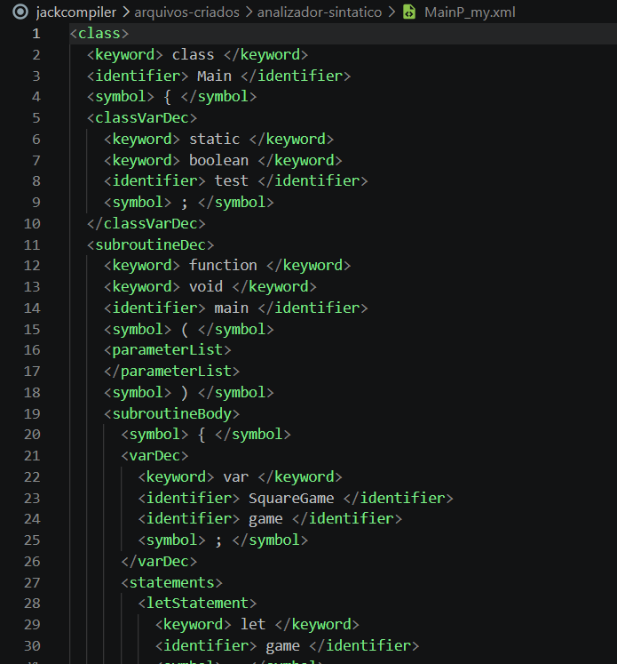

# JackCompiler - Analisador Sintático (JackCompiler)

Este repositório contém a implementação completa do **Analisador Léxico (Scanner)** e do **Analisador Sintático (Parser)** para a linguagem **Jack**, desenvolvidos como parte da Unidade 1 do projeto do compilador (**JackCompiler**) do curso *Nand2Tetris* (Projeto 10).

---

## Identificação da Dupla
* **Integrante 1:** Euderlan Freire da Silva Abreu — **Matrícula:** 20250071198
* **Integrante 2:** Yuram ALmeida Santos — **Matrícula:** 20260060213

---

## 📁 Estrutura do Repositório
```text
jackcompiler/
│
├──analizador-lexico/     # Main_my.xml, Square_my.xml, SquareGame_my.xml
├── analizador-sintatico/ # MainP_my.xml, SquareP_my.xml, SquareGameP_my.xml
├── jack_tokenizer.py     # Analisador Léxico (Scanner)
├── compilation_engine.py # Analisador Sintático (Parser por Descida Recursiva)
├── jack_analyzer.py      # Ponto de entrada do compilador (Integração Léxico + Sintático)
├── test_parser.py        # Suíte de testes automatizados com pytest
├── assets/               # Imagens e diagramas da documentação
├── .gitignore            # Configuração do Git
└── README.md             # Documentação completa do projeto
```
---

##  Como Executar

### 1. Pré-requisitos
Certifique-se de ter o Python 3 instalado no seu sistema e instale a biblioteca `pytest` para testes:

```powershell
pip install pytest
```

### 2. Compilando Arquivos e Diretórios (`jack_analyzer.py`)
O analisador aceita como argumento da linha de comando o caminho absoluto ou relativo para um **arquivo `.jack`** individual ou um **diretório completo** contendo múltiplos arquivos `.jack`.

#### Execução para um arquivo individual:
```powershell
python jack_analyzer.py "C:\Users\EudFr\Downloads\nand2tetris\nand2tetris\projects\10\Square\Square.jack"
```

#### Execução para um diretório inteiro:
```powershell
python jack_analyzer.py "C:\Users\EudFr\Downloads\nand2tetris\nand2tetris\projects\10\Square"
```

**Saída esperada:** Para cada arquivo `Nome.jack` analisado, o sistema cria o arquivo de árvore sintática XML correspondente nomeado como `NomeP_my.xml` no mesmo diretório.

---

##  Estratégia de Testes e Validação Sintática

A validação do analisador sintático foi realizada de forma totalmente **automatizada** através do `pytest`, garantindo que a estrutura hierárquica das tags XML geradas corresponda 100% aos gabaritos do curso *Nand2Tetris*.

### Método de Normalização
Para ignorar diferenças puramente cosméticas de espaçamento e indentação entre sistemas operacionais ou formatadores, os testes utilizam a função `normalize_xml`:

```python
def normalize_xml(content):
    """Remove espaços em branco no início de cada linha para ignorar diferenças de indentação."""
    return '\n'.join(line.strip() for line in content.splitlines() if line.strip())

TEST_CASES = [
    (r"C:\Users\EudFr\Downloads\nand2tetris\nand2tetris\projects\10\Square", "Square"),
    (r"C:\Users\EudFr\Downloads\nand2tetris\nand2tetris\projects\10\Square", "Main"),
    (r"C:\Users\EudFr\Downloads\nand2tetris\nand2tetris\projects\10\Square", "SquareGame"),
    (r"C:\Users\EudFr\Downloads\nand2tetris\nand2tetris\projects\10\ArrayTest", "Main"),
]
```

### Casos de Teste Analisados (`test_parser.py`)
Os testes cobrem tanto estruturas básicas de vetores quanto programas com orientação a objetos completa, manipulação de tela, laços e condicionais:

1. `Square/Square.jack`
2. `Square/Main.jack`
3. `Square/SquareGame.jack`
4. `ArrayTest/Main.jack`

### Execução da Suíte de Testes
Para rodar a bateria de testes automatizados, navegue até a pasta do projeto e execute:

```powershell
pytest test_parser.py
```

### Resultado da Validação Oficial

```text
================================ test session starts ================================
platform win32 -- Python 3.13.11, pytest-9.1.1, pluggy-1.5.0
rootdir: C:\Users\EudFr\OneDrive\Documentos\VSCODEPROJETOS\jackcompiler\jackcompiler
collected 4 items                                                                    

test_parser.py ....                                                            [100%]

================================ 4 passed in 0.04s ==================================
```

## 🖼️ Exemplo Prático: Código Fonte vs. Árvore Sintática XML

Abaixo está a comparação entre o código-fonte original escrito na linguagem Jack e a árvore sintática hierárquica gerada pelo nosso **Analisador Sintático (CompilationEngine)**:

### 1. Código-Fonte Original (`Square.jack`)
O arquivo em texto bruto contendo a estrutura da classe, comentários (`//` e `/* */`), espaços em branco e declarações de variáveis/métodos:


* **Descrição:** Código-fonte de entrada lido pelo analisador. Ele contém instruções brutas da linguagem Jack acompanhadas de comentários e formatação original de texto.

---

### 2. Saída do Analisador Sintático (`MainP_my.xml`)
A estrutura hierárquica em XML gerada pelo *Parser* por descida recursiva:



* **Descrição:** O XML final gerado representa a **Árvore Sintática (Parse Tree)** do programa. Enquanto o analisador léxico produz apenas uma lista plana de tokens soltos, o analisador sintático organiza esses tokens dentro das regras gramaticais da linguagem Jack — agrupando elementos em tags estruturais como `<class>`, `<classVarDec>`, `<subroutineDec>`, `<subroutineBody>`, `<varDec>` e `<statements>`.
---