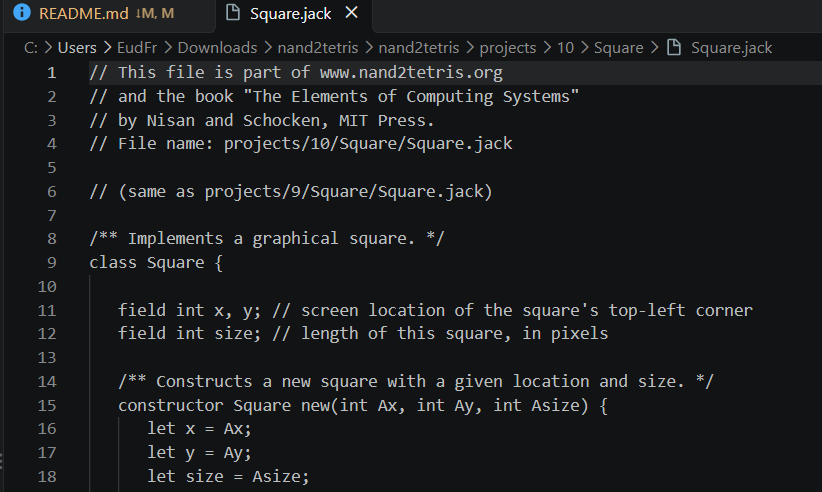
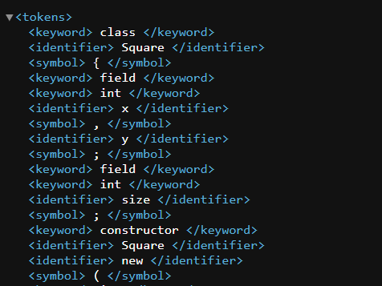

# JackCompiler - Entrega Parcial 1: Analisador Léxico (JackTokenizer)

Este repositório contém a implementação do **Analisador Léxico** (*scanner*) para a linguagem **Jack**, desenvolvido como a primeira etapa do compilador (**JackCompiler**) proposto no curso *Nand2Tetris* (Projeto 10).

---

##  Identificação da Dupla
* **Integrante 1:** Euderlan Freire da Silva Abreu — **Matrícula:** 20250071198
* **Integrante 2:** Yuram ALmeida Santos — **Matrícula:** 20260060213

---

##  Especificações Técnicas e Tecnologias
* **Linguagem de Programação:** Python 3
* **Dependências Externas:** Nenhuma (utiliza apenas a biblioteca padrão do Python, como `re`, `os` e `sys`).
* **Paradigma:** Orientação a Objetos (padrão arquitetural sugerido pelo livro oficial do Nand2Tetris).

---

##  Estrutura do Repositório

```bash
jackcompiler/
│
├── assets/
│   ├── codigo_jack.png    # Print do código fonte (Square.jack)
│   └── tokens_xml.png     # Print da saída do analisador léxico (SquareT_my.xml)
├── jack_tokenizer.py      # Código-fonte principal do Analisador Léxico
├── run_tests.py           # Script automatizado de bateria de testes
├── .gitignore             # Configuração de arquivos ignorados pelo Git
└── README.md              # Documentação completa do projeto
```

---

##  Requisitos Técnicos Implementados

O **`JackTokenizer`** foi projetado para ler o arquivo fonte `.jack`, ignorar elementos irrelevantes e classificar cada token individualmente.

### 1. Tratamento de Ruído
A limpeza do código-fonte é realizada via Expressões Regulares (Regex) antes da etapa de tokenização:
* **Comentários de Linha (`//`):** Removidos até o final da linha.
* **Comentários em Bloco (`/* ... */` e `/** ... */`):** Removidos através de busca não-gananciosa.
* **Espaços em Branco, Tabs e Quebras de Linha:** Ignorados na delimitação dos tokens.

### 2. Categorização dos Tokens
Cada token é classificado em uma das 5 categorias da linguagem Jack:
* **`keyword`**: Palavras reservadas da linguagem (`class`, `constructor`, `function`, `method`, `field`, `static`, `var`, `int`, `char`, `boolean`, `void`, `true`, `false`, `null`, `this`, `let`, `do`, `if`, `else`, `while`, `return`).
* **`symbol`**: Símbolos gráficos (`{`, `}`, `(`, `)`, `[`, `]`, `.`, `,`, `;`, `+`, `-`, `*`, `/`, `&`, `|`, `<`, `>`, `=`, `~`)[cite: 1, 7].
* **`integerConstant`**: Números inteiros no intervalo $0$ a $32767$[cite: 1, 7].
* **`stringConstant`**: Sequência de caracteres entre aspas duplas (as aspas são descartadas na extração do valor)[cite: 1, 7].
* **`identifier`**: Nomes de variáveis, funções, métodos, construtores e classes[cite: 1, 7].

---

##  Instruções de Compilação e Execução

### Pré-requisitos
Certifique-se de ter o Python 3.x instalado em sua máquina.

### Executando em um arquivo individual `.jack`
Para tokenizar um único arquivo e gerar a saída em XML (`T_my.xml`):
```bash
python jack_tokenizer.py caminho/para/arquivo.jack

```
##  Estratégia de Testes e Validação

Escolhemos seguir a **estratégia oficial de teste do Nand2Tetris**, comparando a saída do nosso analisador léxico com os gabaritos em XML (`*T.xml`). A ideia foi garantir que o nosso tokenizador estivesse rodando 100% correto e sem erros antes de partir para a construção do *Parser*.

---

### 1. Formatação do XML Gerado

O nosso código gera os arquivos XML no módulo `generate_tokens_xml` seguindo direitinho os padrões do curso:

* **Tag raiz:** O arquivo inteiro fica dentro das tags `<tokens>` no início e `</tokens>` no final.
* **Espaços internos:** Cada linha mantém um espaço em branco entre as tags e o valor do token, tipo `<keyword> class </keyword>`.
* **Strings sem aspas:** As aspas das cadeias de texto (`stringConstant`) são removidas na hora de salvar o valor no XML.
* **Caractere especial tratado:** Convertemos símbolos que conflitam com a sintaxe do XML:
  * `<` vira `&lt;`
  * `>` vira `&gt;`
  * `"` vira `&quot;`
  * `&` vira `&amp;`
* **Sem token EOF:** O arquivo fecha logo após o último token do código Jack, sem adicionar nada extra no fim.

---

### 2. Arquivos de Teste Utilizados

Rodamos a bateria de testes em todos os arquivos `.jack` do Projeto 10 fornecidos pelo Nand2Tetris:

| Pasta do Projeto | Arquivo de Entrada (`.jack`) | Gabarito de Comparação (`.xml`) |
| :--- | :--- | :--- |
| `projects/10/Square/` | `Square.jack` | `SquareT.xml` |
| `projects/10/Square/` | `Main.jack` | `MainT.xml` |
| `projects/10/Square/` | `SquareGame.jack` | `SquareGameT.xml` |
| `projects/10/ArrayTest/` | `Main.jack` | `MainT.xml` |
| `projects/10/ExpressionLessSquare/` | `Square.jack` | `SquareT.xml` |
| `projects/10/ExpressionLessSquare/` | `Main.jack` | `MainT.xml` |

---

### 3. Como Fizemos a Comparação

Testamos a saída usando duas abordagens simples no terminal:

#### A. Comparação no PowerShell (`Compare-Object`)
No Windows, usamos o próprio PowerShell para checar se o nosso XML gerado (`*T_my.xml`) bateu linha por linha com o oficial (`*T.xml`):

```powershell
# Gerando os XMLs da pasta Square
python jack_tokenizer.py "C:\Users\EudFr\Downloads\nand2tetris\nand2tetris\projects\10\Square"

# Comparando o resultado com o gabarito
# Square.jack
Compare-Object (Get-Content "C:\Users\EudFr\Downloads\nand2tetris\nand2tetris\projects\10\Square\SquareT_my.xml") (Get-Content "C:\Users\EudFr\Downloads\nand2tetris\nand2tetris\projects\10\Square\SquareT.xml")

# Main.jack
Compare-Object (Get-Content "C:\Users\EudFr\Downloads\nand2tetris\nand2tetris\projects\10\Square\MainT_my.xml") (Get-Content "C:\Users\EudFr\Downloads\nand2tetris\nand2tetris\projects\10\Square\MainT.xml")

# SquareGame.jack
Compare-Object (Get-Content "C:\Users\EudFr\Downloads\nand2tetris\nand2tetris\projects\10\Square\SquareGameT_my.xml") (Get-Content "C:\Users\EudFr\Downloads\nand2tetris\nand2tetris\projects\10\Square\SquareGameT.xml")
```
##  Exemplo Prático de Funcionamento

Abaixo está a comparação entre o código-fonte original da linguagem Jack e o resultado gerado pelo nosso analisador léxico:

### 1. Código-Fonte Original (`Square.jack`)
Código bruto com comentários, espaços e quebras de linha:



---

### 2. Saída do Analisador Léxico (`SquareT_my.xml`)
Resultado gerado pelo `JackTokenizer` após remover comentários/espaços e classificar cada palavra em tokens:



> **O que aconteceu na transformação:** 
> O analisador léxico limpou todo o texto do código-fonte (removendo comentários `//` e `/* */`) e converteu cada palavra/símbolo em sua respectiva tag de token (`keyword`, `identifier`, `symbol`, etc.), gerando a lista exata esperada pelo compilador.

# Referências
Nand2Tetris — Projeto 10

Livro: The Elements of Computing Systems — Capítulo 10